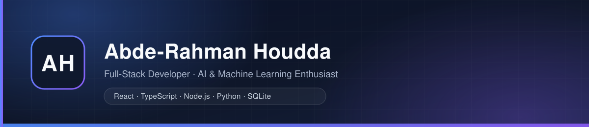

  

  
  

---

## About Me

I'm a **Full-Stack Developer** who enjoys building complete web products end to end — from responsive, accessible frontends to tested RESTful backends and the databases behind them.

- **Frontend** — React and TypeScript, with a focus on polished, accessible interfaces and responsive layouts that work from desktop to mobile.
- **Backend** — Node.js and Express: REST APIs, JWT authentication, and relational data with MySQL and SQLite.
- **Quality** — automated tests at every layer, code review habits, and documentation that makes projects easy to set up and trust.
- **Craft** — I care about the details that make software feel finished: consistent design systems, readable code, and honest READMEs.

I'm currently expanding into **AI & Machine Learning** (see [Learning Journey](#learning-journey)) so I can eventually combine solid full-stack engineering with data-driven intelligence.

## Tech Stack

**Frontend**

**Backend**

**Databases**

**Languages**

**Tools & Platforms**

**Exploring — AI & Machine Learning**

---

## Featured Project

### TaskFlow — Full-Stack Task Management

A complete task-management application — designed, built, and tested end to end, with a hand-crafted **dark glassmorphism** interface.

  

- **JWT authentication** — signup and login with bcrypt password hashing and protected routes.
- **Task CRUD** — create, edit, delete, and complete tasks with validated fields, priorities, due dates, and overdue detection.
- **Search & filters** — real-time search across titles and descriptions, combined with status and priority filters.
- **Dashboard statistics** — live task counts, status breakdowns, and completion progress.
- **Dark glassmorphism UI** — a custom design system with frosted-glass panels, neon blue/purple accents, WCAG 4.5:1 text contrast, keyboard-navigable forms, and a `prefers-reduced-motion` fallback.
- **97 automated tests** — 46 backend (Jest + Supertest), 34 frontend (Vitest + Testing Library), and 17 end-to-end (Playwright).

  
  &nbsp;&nbsp;
  

→ **[github.com/Abderahmanhoudda/TaskFlow](https://github.com/Abderahmanhoudda/TaskFlow)** — full README, API documentation, setup guide, and 10 screenshots.

---

## Learning Journey

I'm currently deepening my skills in **Python** and building my foundations in **Artificial Intelligence**, **Machine Learning**, and **Data Analysis**.

My goal is straightforward: become a developer who can ship reliable full-stack products *and* understand the data and models that make them smarter. I study core concepts, work through hands-on practice, and keep documenting what I learn along the way.

---

## Connect

- **GitHub** — [github.com/Abderahmanhoudda](https://github.com/Abderahmanhoudda)
- **LinkedIn** — [Abde-Rahman Houdda](https://www.linkedin.com/in/abde-rahman-houdda)
